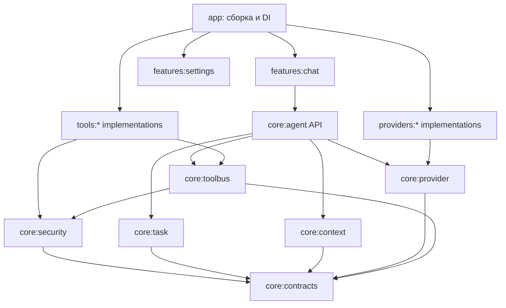

# UMNIK 2 — дерево модулей и карта реорганизации исходников

**Статус:** целевая структура существующего `Ayuemin/Umnik`, ещё НЕ реализована. Сейчас корневой `settings.gradle.kts` включает только `:app`. Каталоги ниже создаются и наполняются ПОЭТАПНО, без леса пустых классов. Источник архитектуры — `PRODUCT_BLUEPRINT.md`. **Актуальные статусы и чек-лист — только `docs/ROADMAP.md` в GitHub, ветка `work/modular-umnik-v2`**; копию Roadmap в источники ChatGPT не добавлять.

## Текущая и целевая структура — не путать

**Исходная структура на 13.10.2026:** один Gradle-модуль `:app`; крупные файлы `ChatViewModel.kt`, `ui/YmnikApp.kt`, `network/OpenRouterClient.kt`, `ui/SettingsScreen.kt`, `browser/LocalBrowserRuntime.kt`; узлы `agenttools/`, `network/`, `ui/`, `data/`, `audio/`, `tts/`. В `agenttools/` уже есть `ToolRegistry`, `AgentToolHub`, `ToolDescriptor`, `GuardedToolDispatcher`, `GitHubAgentTool`; повторно создавать эти реализации под другим именем запрещено без решения о замене.

**Цель:** реальная Gradle-изоляция нового кода; legacy `:app` временно пользуется адаптерами к новым контрактам, пока старые классы не опустеют. Новый репозиторий не требуется; ветка создана: `work/modular-umnik-v2`. Исходные версии и статусы всегда перепроверять по GitHub.

## Физическая структура

```text
Ayuemin/Umnik/  # существующий репозиторий, новая рабочая ветка
├── AGENTS.md                         # Правила для любого разработчика/агента
├── README.md                         # Назначение, сборка, установка, состояние
├── LICENSE                           # Сохраняем существующую лицензию; сторонний код — отдельный аудит
├── settings.gradle.kts               # Только зарегистрированные модули
├── build.gradle.kts
├── gradle.properties
├── gradle/
│   └── libs.versions.toml            # Каталог зависимостей и версий
├── build-logic/                      # Gradle convention plugins при необходимости
├── .github/
│   └── workflows/
│       ├── android-fast.yml          # Unit, static checks, debug APK
│       ├── android-full.yml          # Lint, unit, instrumentation (где есть device), R8
│       └── security.yml              # Dependency/license/security checks
├── docs/
│   ├── PRODUCT_BLUEPRINT.md          # Требования Umnik 2, UX, безопасность, миграция
│   ├── PROJECT_TREE.md               # Этот документ: обязательная структура
│   ├── ROADMAP.md                    # ЕДИНСТВЕННЫЙ живой чек-лист (в GitHub)
│   ├── MIGRATION_INVENTORY.md        # Создать после аудита: судьба реальных файлов
│   ├── TOOL_CONTRACT.md              # JSON-schema, tool/session/progress/errors
│   ├── PROVIDER_CONTRACT.md          # Capability matrix, caching и billing
│   ├── BROWSER_RESEARCH.md           # Сравнение Android Browser решений
│   ├── THREAT_MODEL.md               # Секреты, границы доверия, WebView, SSRF
│   ├── TEST_MATRIX.md                # Реальные сценарии + критерии приёмки
│   └── DECISIONS/                    # Короткие ADR: причина/решение/альтернативы
├── app/                               # ЦЕЛЬ: только composition root; СЕЙЧАС: старый монолит, декомпозировать
│   └── src/main/java/<package>/
│       ├── AgentApplication.kt       # DI и инициализация
│       ├── MainActivity.kt           # Навигация/permissions entry
│       └── AppNavigation.kt          # Маршруты экранов
├── core/
│   ├── contracts/                    # :core:contracts — чистые типы/интерфейсы
│   │   └── src/main/kotlin/.../
│   │       ├── TaskId.kt
│   │       ├── ToolId.kt
│   │       ├── ToolDescriptor.kt
│   │       ├── ToolCall.kt
│   │       ├── ToolResult.kt
│   │       ├── ToolProgress.kt
│   │       ├── ArtifactId.kt
│   │       ├── ProviderCapabilities.kt
│   │       └── AgentEvent.kt
│   ├── agent/                        # :core:agent — агентный цикл, без Compose
│   │   └── src/main/kotlin/.../
│   │       ├── AgentRunner.kt
│   │       ├── ToolCallPlanner.kt
│   │       ├── ToolResultIntegrator.kt
│   │       ├── CompletionVerifier.kt
│   │       ├── MissionAnchor.kt
│   │       ├── AgentRunState.kt
│   │       └── AgentCancellation.kt
│   ├── task/                         # :core:task — задачи/очереди/checkpoint
│   │   └── src/main/kotlin/.../
│   │       ├── TaskCoordinator.kt
│   │       ├── TaskGraph.kt
│   │       ├── TaskScheduler.kt
│   │       ├── TaskCheckpoint.kt
│   │       ├── TaskRetryPolicy.kt
│   │       └── TaskRecovery.kt
│   ├── toolbus/                      # :core:toolbus — единая шина
│   │   └── src/main/kotlin/.../
│   │       ├── ToolAdapter.kt
│   │       ├── ToolRegistry.kt
│   │       ├── ToolDispatcher.kt
│   │       ├── ToolCatalogSelector.kt
│   │       ├── ToolSessionManager.kt
│   │       └── ToolExecutionObserver.kt
│   ├── provider/                     # :core:provider — API-провайдеры
│   │   └── src/main/kotlin/.../
│   │       ├── LlmProvider.kt
│   │       ├── ProviderRegistry.kt
│   │       ├── ProviderConfig.kt
│   │       ├── ProviderRouter.kt
│   │       ├── ResponseStreamDecoder.kt
│   │       ├── ProviderErrorMapper.kt
│   │       ├── ModelCapabilityResolver.kt
│   │       └── usage/
│   │           ├── TokenUsageNormalizer.kt
│   │           ├── UsageLedger.kt
│   │           ├── CostLedger.kt
│   │           └── ModelPriceSnapshot.kt
│   ├── context/                      # :core:context — промпт и кеш
│   │   └── src/main/kotlin/.../
│   │       ├── ContextAssembler.kt
│   │       ├── StablePrefixBuilder.kt
│   │       ├── CachePolicy.kt
│   │       ├── ContextBudget.kt
│   │       ├── HistoryCompactor.kt
│   │       └── ToolResultSummarizer.kt
│   ├── security/                     # :core:security — runtime gate
│   │   └── src/main/kotlin/.../
│   │       ├── TaskGrant.kt
│   │       ├── PermissionGate.kt
│   │       ├── RiskClassifier.kt
│   │       ├── ApprovalRequest.kt
│   │       ├── ConnectionSecretRef.kt
│   │       ├── SecretVault.kt
│   │       └── AuditSanitizer.kt
│   ├── storage/                      # :core:storage — Room/DataStore/SAF
│   │   └── src/main/kotlin/.../
│   │       ├── ChatRepository.kt
│   │       ├── MessageRepository.kt
│   │       ├── TaskRepository.kt
│   │       ├── ProviderConfigRepository.kt
│   │       ├── ArtifactRepository.kt
│   │       └── DatabaseMigrations.kt
│   └── diagnostics/                  # :core:diagnostics — telemetry без секретов
│       └── src/main/kotlin/.../
│           ├── RunEventLog.kt
│           ├── ProviderUsageLog.kt
│           ├── SafeLogRedactor.kt
│           └── DebugReportExporter.kt
├── providers/                        # Не меняют :core:agent или UI
│   ├── openai-compatible/             # :providers:openai-compatible
│   │   └── .../OpenAiCompatibleAdapter.kt
│   ├── anthropic/                     # :providers:anthropic
│   │   └── .../AnthropicAdapter.kt
│   ├── gemini/                        # :providers:gemini
│   │   └── .../GeminiAdapter.kt
│   └── openrouter/                    # :providers:openrouter (не обязателен)
│       └── .../OpenRouterAdapter.kt
├── features/
│   ├── chat/                          # :features:chat — только экран чата
│   │   └── src/main/java/.../
│   │       ├── ChatScreen.kt
│   │       ├── ChatViewModel.kt       # Только UI state + dispatch
│   │       ├── ChatUiState.kt
│   │       ├── ChatComposer.kt
│   │       ├── ChatMessageCard.kt
│   │       ├── AnswerActionsBar.kt   # Копировать, озвучить, «⋮»
│   │       ├── AnswerMoreMenu.kt
│   │       ├── AgentProgressCard.kt
│   │       └── AnswerUsageSheet.kt
│   ├── settings/                      # :features:settings — API/тема/шрифты/звуки
│   │   └── src/main/java/.../
│   │       ├── SettingsScreen.kt
│   │       ├── ProviderSettingsScreen.kt
│   │       ├── ToolConnectionsScreen.kt
│   │       ├── AppearanceScreen.kt
│   │       └── NotificationSoundsScreen.kt
│   ├── voice/                         # :features:voice — OFFLINE STT
│   │   └── src/main/java/.../
│   │       ├── DictationController.kt
│   │       ├── SpeechModelManager.kt
│   │       ├── OfflineSpeechEngine.kt
│   │       ├── DictationUiState.kt
│   │       └── VoicePermissionRequest.kt
│   └── speech/                        # :features:speech — TTS ответов
│       └── src/main/java/.../
│           ├── AnswerSpeechController.kt
│           └── SpeechPlaybackState.kt
├── tools/                              # Каждый инструмент изолирован
│   ├── browser/                       # :tools:browser — приоритет №1
│   │   └── src/main/java/.../
│   │       ├── BrowserToolAdapter.kt
│   │       ├── BrowserSession.kt
│   │       ├── BrowserWebViewHost.kt
│   │       ├── BrowserNavigationPolicy.kt
│   │       ├── BrowserObservation.kt
│   │       ├── SemanticSnapshot.kt
│   │       ├── BrowserElementRef.kt
│   │       ├── BrowserActionExecutor.kt
│   │       ├── BrowserVisualFallback.kt
│   │       ├── BrowserWaitConditions.kt
│   │       ├── BrowserDownloads.kt
│   │       ├── BrowserUserTakeover.kt
│   │       └── BrowserSecurityGate.kt
│   ├── github/                        # :tools:github
│   │   └── .../
│   │       ├── GitHubToolAdapter.kt
│   │       ├── GitHubRestClient.kt
│   │       ├── GitHubRepoOperations.kt
│   │       ├── GitHubFileOperations.kt
│   │       ├── GitHubActionsOperations.kt
│   │       ├── GitHubArtifactImporter.kt
│   │       └── GitHubApprovalPolicy.kt
│   ├── shell/                         # :tools:shell
│   │   └── .../ShellToolAdapter.kt
│   ├── files/                         # :tools:files
│   │   └── .../FilesToolAdapter.kt
│   └── ssh/                           # :tools:ssh — после браузера/GitHub
│       └── .../SshToolAdapter.kt
├── integrations/                       # MCP и внешние подключения
│   └── mcp/                           # :integrations:mcp
│       └── .../McpConnectionAdapter.kt
├── testing/
│   ├── fake-provider/                  # Исчерпывающие usage / stream / errors
│   ├── fake-tools/                     # Нестабильность, retry, revoke, conflicts
│   ├── browser-fixtures/               # Тестовый сайт и DOM/screenshot cases
│   └── scenarios/                      # E2E из docs/TEST_MATRIX.md
└── scripts/
    ├── check-module-dependencies.*
    ├── check-source-size.*
    └── inspect-apk.*
```

## Ограничения дерева

1. `:app` является **composition root**: здесь DI-связывание поставщиков и инструментов, но нет функций поиска, навигации, обработки JSON и логики API.
2. `:features:chat` не зависит от `:tools:*` и `:providers:*`; только от API ядра. UI отправляет `UserIntent`, получает `ChatUiState`/`Flow<AgentEvent>`.
3. `:core:contracts` не зависит от Android, Compose, конкретных provider SDK и других модулей. Это стабильный протокол типов.
4. `:core:agent` зависит от интерфейсов `:core:toolbus`, `:core:provider`, `:core:context`, `:core:task`, а не от Browser/GitHub/SSH-реализаций.
5. `:tools:browser`, `:tools:github`, `:tools:files` не зависят друг от друга и не получают общий `SecretVault` напрямую.
6. `:core:security` проверяет `TaskGrant` и доступ к реальным ресурсам. Не разрешать инструментам самостоятельно повышать права.
7. `:core:storage` — единое хранилище сообщений/задач/артефактов; специализированные таблицы добавлять через явные интерфейсы.
8. Каталог `providers/` расширяется адаптерами; нельзя вставлять условие `if (provider==...)` в экран чата.
9. Kotlin файлы обычно 80–300 строк; сложные 400+ проверять на разделение. Только документированное исключение может превышать 600 строк. CI выдаёт предупреждение при 400 и блокирует необоснованное превышение 600 (порог уточняется по фактическим метрикам).
10. Каждому production-модулю соответствует `src/test` и при необходимости `src/androidTest`. Запреты импорта и циклических зависимостей проверяются автоматически.

## Направление зависимостей



Ни один из обратных путей запрещённых зависимостей не допускается: `contracts → UI`, `agent → browser implementation`, `browser → ChatViewModel`, `provider → ToolAdapter` и т. п.

## Реалистичный старт миграции (не создавать пустой лес модулей)

**Итерация A — без массовых переносов:** оставить работающий `:app`, добавить отдельный `:core:contracts` с моделями, `:core:toolbus` с интерфейсами и тестовым инструментом, `:core:provider` с контрактом LLM. Не создавать параллельных вариантов `AgentToolHub` и `ToolRegistry`; действующие классы оборачивать переходными адаптерами либо переносить с историей Git.

**Итерация B — фактическая декомпозиция:** `:core:agent`, `:core:security`, `:core:context`/`usage`, `:core:storage`, `:features:chat`, `:providers:openrouter`. Переносить согласованные куски из `ChatViewModel`, `OpenRouterClient`, `YmnikApp` маленькими PR/коммитами с сохранением контрольного APK.

**Итерация C — реальные инструменты:** `:tools:github`, `:tools:browser`, `:tools:shell`, `:tools:files`, `:features:voice`, `:features:speech`. Отдельный runtime-gate и реальное Android E2E для каждого. `:tools:ssh`, `:integrations:mcp`, новые `:providers:*` добавлять после стабильных контрактов.

**Итерация D — чистка:** после прохождения переноса удалять старые callbacks, дублирующие storages/DI, ненужные экраны и функции по `MIGRATION_INVENTORY.md`. Избыточные модули, создающие зависимость без пользы, запрещены так же, как классы-комбайны.

## Карта переноса текущих крупных компонентов

| Сейчас в `:app` | Куда и как переносить | Что проверять |
| --- | --- | --- |
| `ChatViewModel.kt` | `:features:chat` state + `:core:agent` use cases + `:core:task` coordinator | Долгие ответы, сохранение истории, отмена, Android lifecycle |
| `ui/YmnikApp.kt` | `:features:chat` UI + `:features:settings` + `:app` navigation | Панель ответа, keyboard, фон, темы, настройки |
| `network/OpenRouterClient.kt` | `:providers:openrouter` + `:core:provider` protocol + cache/usage | SSE, tool calls, billing, recovery, provider parity |
| `network/OpenRouter*Parser.kt` | Соответствующие provider adapters/usage | Null/0 cache, неполный SSE, reasoning |
| `agenttools/*` | `:core:toolbus` и `:core:security` + `:tools:github` | Реальные права на side effects, отмена и mock tests |
| `browser/LocalBrowserRuntime.kt` и `ui/LocalBrowserHost.kt` | `:tools:browser` + отдельный UI takeover | Реальные URL/redirects, DOM/refs, screenshots, секреты |
| `LocalShellRuntime.kt` и связанные файлы | `:tools:shell`, контракт артефактов/безопасности | Sandbox, память, worker lifecycle, повторные вызовы |
| `audio/`, `tts/`, `ui/UserFontStore.kt`, `ui/UmnikTheme.kt` | `:features:voice`, `:features:speech`, `:features:chat` design | Офлайн STT, озвучивание, внешний вид |
| `data/`, файловые модели | `:core:storage`, `:tools:files` по границам | Не создавать второй database/file storage; backup перед чисткой |

Это **кандидатная карта**, не утверждение полного охвата зависимостей. Точные файлы и решения должны войти в создаваемый после аудита `docs/MIGRATION_INVENTORY.md`.

## Контракт добавления нового инструмента

Новый инструмент добавляется только так:

```text
1. tools/<tool>/.../ToolAdapter.kt   (единый интерфейс)
2. tools/<tool>/.../*Policy.kt       (фактические ресурсы/доступ)
3. tools/<tool>/.../*Client.kt       (внешнее API или Android runtime)
4. tools/<tool>/src/test/...        (mock и отрицательные тесты)
5. composition root registration    (одна запись в каталоге/DI)
6. docs/ROADMAP.md                  (обновить единственный GitHub чек-лист)
```

Если для этого требуется изменить `ChatViewModel`, `AgentRunner` и экран провайдеров одновременно — сначала объяснить причину и исправить контракт, а не делать обходы.

## Ограничение правила «одна функция — один класс»

Применять как **одна ответственность — один класс или небольшой связный набор функций**. Отдельные преобразования, валидаторы и форматирование могут быть top-level pure functions. Не превращать проект в тысячи бессодержательных классов: сложность определяется зависимостями и назначением, а не только количеством строк.